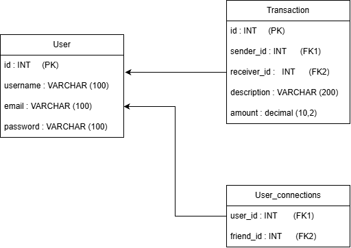

# Pay My Buddy

Application web de transfert d'argent entre amis (prototype).

## Modèle physique de données (MPD)

## Scripts SQL

- [schema.sql](src/main/resources/schema.sql) : création de la base et des tables
- [data.sql](src/main/resources/data.sql) : jeu de données de test

## Configuration

L'application lit les identifiants de la base dans des variables d'environnement :

- `DB_USERNAME`
- `DB_PASSWORD`

Aucun identifiant n'est stocké dans le code.

